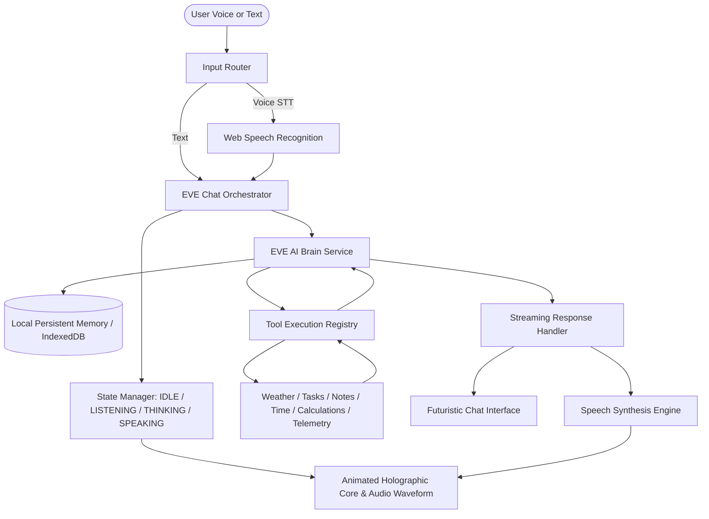

# PROJECT EVE — Your Personal AI Assistant
> **Enhanced Virtual Entity (EVE)** — A personal AI companion inspired by JARVIS from Iron Man, featuring a holographic core, voice interaction, intelligent reasoning, and an extensible tools ecosystem.


---

## 1. Overview & Vision

**EVE** is designed not as a basic chatbot, but as an elegant, capable personal AI companion. Operating from a futuristic command center with midnight obsidian, cyan neon (`#00f3ff`), and electric blue (`#0066ff`) aesthetics, EVE assists with daily productivity, research, task tracking, weather telemetry, system diagnostics, and voice commands.

---

## 2. Key Capabilities

### 🌐 Futuristic Holographic Interface
* **60 FPS Animated Canvas Core:** Multi-ring gyroscopic rotation with a 3D orbital particle cloud responding dynamically to system states (`IDLE`, `LISTENING`, `THINKING`, `SPEAKING`).
* **Live Audio Waveform:** Real-time multi-bar frequency spectrum utilizing the HTML5 Web Audio API `AnalyserNode`.
* **Telemetry HUD:** Live chronometer, graphics refresh rate (FPS), privacy sandbox badge, and quick action toggles.
* **Cinematic Chat Stream:** Streaming text output with typing cursor, message history, tool execution cards, copy button, and spoken playback.

### 🎙️ Natural Voice Interaction
* **Speech-to-Text (STT):** Hands-free voice recognition via the browser Web Speech API.
* **Text-to-Speech (TTS):** Natural vocal synthesis with customizable speed, pitch, and voice profile selection.
* **Interruptible Playback:** Clicking or speaking immediately halts active speech synthesis.
* **Futuristic Sound Chimes:** Zero-latency Web Audio API synthesizers generating startup arpeggios, listening beeps, and confirmation chimes.

### 🧠 Dual-Mode AI Brain
* **Google Gemini Integration:** Connect your Gemini API key (via Settings or `.env.local`) to utilize `gemini-1.5-flash`, `gemini-1.5-pro`, or `gemini-2.0-flash`.
* **Autonomous Local Persona:** If no API key is provided or the device is offline, EVE's built-in heuristic reasoning matrix operates locally with zero external API calls.
* **JARVIS-Inspired Persona:** Composed, polite, intelligent, and proactive.

### 🛠️ Smart Assistant Tools Registry
* **Weather Telemetry:** Check atmospheric conditions and forecasts for any global city.
* **Task Ledger:** Add, toggle, delete, and prioritize tasks with priority tags (`HIGH`, `MED`, `LOW`).
* **Dossier & Notes:** Record categorized notes, research thoughts, and code snippets.
* **World Clock:** Instant local time, date, and UTC synchronization.
* **Math & Computations:** Secure calculation engine for math expressions and conversions.
* **System Telemetry:** Real-time JS heap memory, screen resolution, network connectivity, and hardware concurrency.

---

## 3. System Architecture & Data Flow



---

## 4. Getting Started

### Prerequisites
* **Node.js:** v18.0.0 or higher (v22+ recommended)
* **npm:** v9.0.0 or higher

### Installation

1. **Clone the repository:**
   ```bash
   git clone https://github.com/OxxY-ScoobY/EVE.git
   cd EVE
   ```

2. **Install dependencies:**
   ```bash
   npm install
   ```

3. **Start the local development server:**
   ```bash
   npm run dev
   ```
   EVE will launch locally at `http://127.0.0.1:5173/`.

4. **Production Build & Verification:**
   ```bash
   # Run TypeScript compilation and production build
   npm run build

   # Run Oxlint verification
   npm run lint
   ```

---

## 5. Configuration

EVE is fully functional out-of-the-box in standalone mode. To connect Google's Gemini models:

1. Click the **Settings Gear** icon in the top-right header of the application.
2. Enter your Gemini API key in the masked field and click **Save Configuration**.
3. *Alternatively*, create a `.env.local` file from the provided `.env.example`:
   ```bash
   cp .env.example .env.local
   ```
   Add your key:
   ```env
   VITE_GEMINI_API_KEY=your_actual_gemini_api_key_here
   VITE_GEMINI_MODEL=gemini-1.5-flash
   ```

---

## 6. Codebase Structure

```
EVE/
├── public/                 # Static assets and icons
├── src/
│   ├── components/         # Futuristic UI components
│   │   ├── HolographicCore.tsx   # 60fps canvas particle gyro orb
│   │   ├── AudioWaveform.tsx     # Frequency audio visualizer
│   │   ├── StatusIndicator.tsx   # Glowing LED status pill
│   │   ├── TelemetryHUD.tsx      # Top bar with clock, FPS, toggles
│   │   ├── ChatStream.tsx        # Conversation feed and tool cards
│   │   ├── ChatInput.tsx         # Voice mic button and command input
│   │   ├── ToolsDrawer.tsx       # Tasks, Notes, Weather, Telemetry drawer
│   │   ├── SettingsModal.tsx     # API key, voice tuning, memory reset
│   │   └── ErrorBoundary.tsx     # Futuristic crash recovery UI
│   ├── config/             # System prompts and default settings
│   │   ├── systemPrompt.ts       # EVE's JARVIS-inspired identity
│   │   └── defaultSettings.ts    # Config keys and default values
│   ├── services/           # Core subsystems
│   │   ├── aiService.ts          # Gemini API + local heuristic engine
│   │   ├── audioVisualizer.ts    # Web Audio API synthesizers and analyzer
│   │   ├── memoryService.ts      # Client-side persistence (notes/tasks/history)
│   │   ├── speechService.ts      # Web Speech API STT and TTS engine
│   │   └── toolRegistry.ts       # Weather, tasks, notes, search, diagnostics
│   ├── styles/             # Futuristic design tokens and animations
│   │   ├── eve-theme.css         # Glassmorphism, cyan glow, dark theme
│   │   └── animations.css        # Particle pulse, radar, scanlines
│   ├── types/
│   │   └── eve.ts                # TypeScript contracts and interfaces
│   ├── App.tsx             # Root application orchestrator
│   ├── index.css           # Full-screen responsive viewport layout
│   └── main.tsx            # React root with ErrorBoundary
├── .env.example            # Documented environment template
├── .gitignore              # Production git ignore configuration
├── package.json            # Scripts and dependencies
└── tsconfig.json           # Strict TypeScript configuration
```

---

## 7. Security & Sandboxing

* **Zero Hardcoded Secrets:** No API keys or passwords are stored in code.
* **Client-Side Enclave:** Conversation history, memory, and personal tasks remain stored in `localStorage` on the local machine origin.
* **Microphone Permissions:** Standard browser permission prompts are required before the microphone activates.
* **Interruptible:** Audio synthesis and recognition can be silenced with a single click.

---

## 8. License

Distributed under the MIT License. Built with passion for futuristic human-AI interaction.
