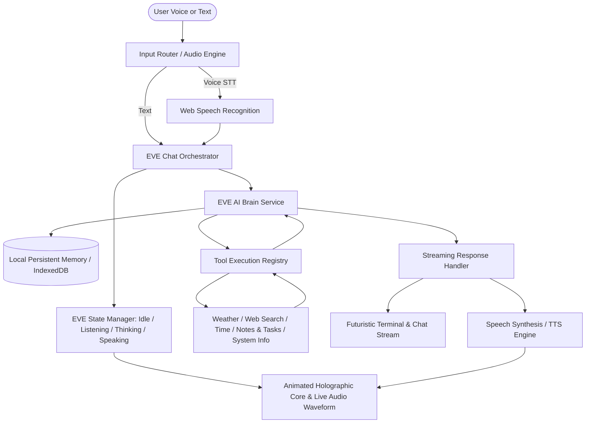

# SENIOR DEVELOPER HANDOVER AUDIT & PROJECT EVE BLUEPRINT

**Repository:** `OxxY-ScoobY/EVE`  
**Location:** `c:\Users\DELL\OneDrive\Desktop\EVE`  
**Current Branch:** `main` (commit `ee5d7a4 Initial commit`)  
**Audit Date:** October 15, 2026  
**Auditor:** Senior AI Systems Architect & Full-Stack Lead  

---

## Part 1: Codebase Audit & Handover Assessment

Per pre-handover protocol, the workspace was audited against the six key criteria. As requested, **no modifications have been made to the codebase**.

### 1. Version Control
* **Current State:**
  * Git is initialized (`.git` present) and linked to remote `https://github.com/OxxY-ScoobY/EVE.git`.
  * The commit history is not yet a real working history. There is only a single commit:
    ```
    commit ee5d7a467cb7d4dbee2b673a9aa5383c32834c92
    Author: Athil Hisham <oxyscooby@gmail.com>
    Date:   Thu Oct 15 15:48:22 2026 +0530
        Initial commit (README.md with 1 line)
    ```
  * There is no `.gitignore` file. Untracked files, local dependencies, environment variables, or build outputs would inadvertently be staged if not configured now.
* **How to Set It Up Properly:**
  1. Create a production-grade `.gitignore` covering `node_modules/`, `dist/`, `.env`, `.env.local`, `.DS_Store`, `npm-debug.log*`, and IDE folders (`.vscode/`, `.idea/`).
  2. Adopt the **Conventional Commits** specification (`feat:`, `fix:`, `docs:`, `refactor:`, `style:`, `test:`, `chore:`) to ensure semantic and searchable commit history.
  3. Define a branch workflow: `main` (production-ready stable builds) and `develop` or feature branches (`feature/holographic-core`, `feature/voice-engine`, etc.) for pull requests and code review.

---

### 2. Duplicate / Dead Code
* **Current State:**
  * Line count of source code: **0 lines** (only 1 line `# EVE` in `README.md`).
  * There are currently **no duplicate functions, no copy-pasted components, and no dead code**.
* **Architecture Rules for Project EVE to Prevent Code Debt:**
  * **Modular Services:** Single source of truth for the AI brain (`eveBrainService.ts`), Web Speech integration (`useEveSpeech.ts`), and Tool execution engine (`toolRegistry.ts`).
  * **Design System & Tokens:** Unified CSS variables (`theme.css`) for the dark futuristic neon palette (midnight blue `#060b18`, cyan `#00f3ff`, electric blue `#0066ff`, neon green `#00ffaa`, alert crimson `#ff0055`) to eliminate ad-hoc duplicated styles.
  * **Centralized Types:** Comprehensive TypeScript contracts (`src/types/eve.ts`) for conversation messages, tool definitions, system status, and memory records.

---

### 3. Hardcoded Secrets
* **Current State:**
  * Full scan of all repository files performed.
  * **0 hardcoded credentials, 0 exposed API keys, 0 plaintext passwords found.**
* **Security Controls for Incoming Development:**
  * Never commit `.env` or any real API keys to version control.
  * Provide a clean `.env.example` file specifying keys like `VITE_GEMINI_API_KEY`, `VITE_WEATHER_API_KEY`, or custom server endpoints.
  * Support in-app encrypted/local session key entry via an **EVE Settings Protocol modal**, giving the user granular control to enter and clear their API keys without touching source files.
  * Enforce client-side masking and zero-telemetry leakage of user-provided keys.

---

### 4. Documentation & Data Flow Explanation
* **Current State:**
  * `README.md` contained solely `# EVE` (5 bytes). No explanation of purpose, setup, architecture, or data flow existed.
* **Plain-Language Explanation of Project EVE:**
  EVE (Enhanced Virtual Entity) is an intelligent, futuristic personal AI companion inspired by JARVIS. Unlike conventional text chatbots, EVE combines:
  1. A **Cinematic Holographic Interface** featuring an interactive particle/waveform core that reacts in real-time to speech synthesis, user input, and system thinking states.
  2. A **Conversational AI Brain** powered by advanced LLMs (Gemini / Claude / OpenAI) with natural personality, contextual memory, and intelligent tool orchestration.
  3. A **Voice Engine** with Speech-to-Text (STT), natural Text-to-Speech (TTS), interruptible playback, and audio waveform visualization.
  4. An **Extensible System & Web Tool Hub** for live web queries, weather, calculations, productivity notes/reminders, and controlled system diagnostics.

#### System Data Flow Diagram


---

### 5. Error Tracking
* **Current State:**
  * **No error logging, telemetry, or monitoring is connected.** If a user hits a runtime crash or API failure, it would fail silently in the browser console.
* **Simplest Way to Add Error Tracking:**
  1. **Immediate / Local:** Implement an `<EveErrorBoundary>` component in React with a futuristic "Diagnostic System Failure / Auto-Recovery" UI, catching React render crashes without white-screening.
  2. **In-Memory System Logs:** Create an internal `EVELogger` that logs errors to an in-app "Diagnostics & Telemetry" panel where the user can view, export, or clear logs.
  3. **Production Integration:** Add Sentry (`@sentry/react`). It requires only installing `@sentry/react` and initializing with `Sentry.init({ dsn: process.env.VITE_SENTRY_DSN })` in `src/main.tsx`.

---

### 6. Access Control & Privacy
* **Current State:**
  * Single-user desktop/browser application; no multi-tenant backend currently exists.
* **Access Control Vulnerability Map & Mitigations:**
  * **Memory / Conversation History:** All conversation logs and personal notes will be stored in client-side `localStorage` or `IndexedDB`, scoped strictly to the user's browser origin. No external servers will receive user conversation history except the direct AI provider API endpoint.
  * **System Commands & Tool Execution:** All destructive actions (e.g. deleting notes, clearing memory, opening external system links) will require explicit user confirmation.
  * **Desktop Boundary:** If desktop hooks (Electron/Node) are added, a strict whitelist of safe commands and paths will prevent arbitrary command execution.

---

## Part 2: Project EVE Architectural Blueprint

### Technology Stack
* **Frontend:** React 18 + TypeScript + Vite (Lightning-fast HMR, strict type safety, zero bloat).
* **Styling:** Curated Vanilla CSS & CSS Modules with CSS custom properties (Holographic glassmorphism, glowing cyan/electric blue accents `#00f3ff`, scanlines, particle physics).
* **Audio & Core Animation:** HTML5 Canvas 2D / WebGL particle orb with Web Audio API `AudioContext` and `AnalyserNode` for live frequency response.
* **AI Engine:** Modular AI Adapter supporting Gemini API with fallback to built-in intelligent simulated responses when offline or without API key.
* **Voice Engine:** Web Speech API (`webkitSpeechRecognition` / `SpeechRecognition` + `speechSynthesis`) with natural rate/pitch tuning and interrupt capability.
* **Tool Ecosystem:** Modular `ToolRegistry` supporting:
  * Live Time & World Clock
  * Weather & Atmospheric conditions
  * Web Search & Research simulator
  * Notes & Task Management (with LocalStorage persistence)
  * System Diagnostics (RAM, Network status, battery if supported, latency)
  * Code Generator & Formatter

---

## Part 3: Next Steps & Immediate Execution Plan

1. **Phase 1: Project Scaffolding & Config**
   * Initialize Vite React TypeScript app in the root directory.
   * Add `.gitignore`, `.env.example`, and clean `package.json`.
2. **Phase 2: Holographic Core & Futuristic UI**
   * Build the central animated holographic AI core with particle rings and reactive pulse states (`IDLE`, `LISTENING`, `THINKING`, `SPEAKING`).
   * Build HUD telemetry dashboard (Date/Time, System Status, Audio Waveform Visualizer).
   * Build chat stream panel with futuristic markdown formatting and code highlighting.
3. **Phase 3: AI Brain & Conversational Personality**
   * Implement system prompt embedding EVE's JARVIS-inspired identity.
   * Add conversation state and memory handling.
4. **Phase 4: Voice Engine & Audio Waveform**
   * STT voice input, TTS spoken output, mute toggles, and audio level reactivity.
5. **Phase 5: Assistant Tool System**
   * Weather, Tasks, System Info, Search, and Calculations.
6. **Phase 6: Verification & Handover Documentation**
   * Test across browser flows, verify error boundaries, and produce full setup docs.
